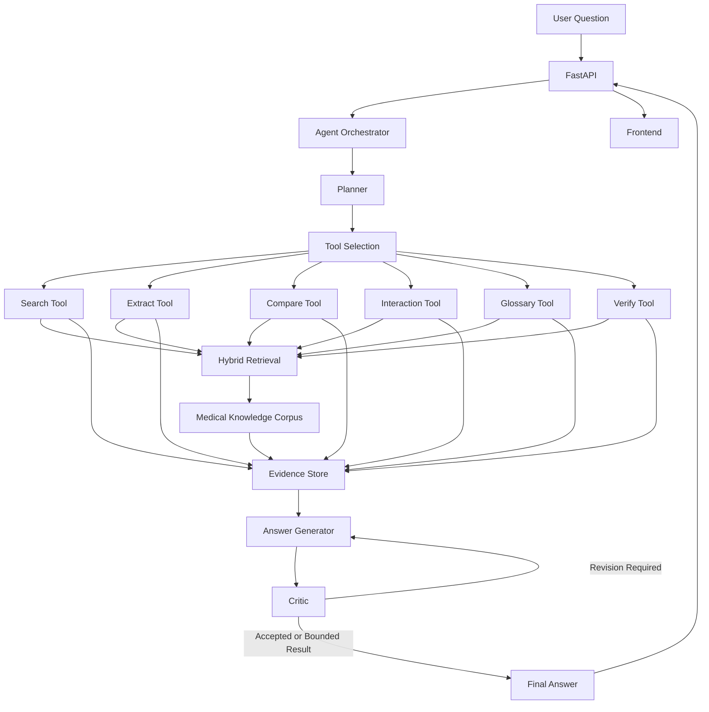

# GENAI AGENT — RAG SYSTEM

**ENSAM RABAT × SYNTAX · TECHNICAL CASE STUDY 2026**

An Agentic Retrieval-Augmented Generation (RAG) system designed to answer questions using a curated medical knowledge corpus. It combines hybrid retrieval, tool-based reasoning, evidence-grounded generation, and automated answer evaluation.

---

## 1. Project Overview

### Problem Statement

Traditional Large Language Models (LLMs) can generate fluent answers, but they may also produce inaccurate or unsupported information, particularly in specialized domains such as healthcare.

A reliable knowledge-based system must therefore:

- Retrieve relevant information from trusted documents.
- Ground generated answers in retrieved evidence.
- Support different question types, including factual, comparative, and multi-hop questions.
- Identify insufficient evidence and avoid unsupported conclusions.
- Evaluate retrieval quality, answer quality, reliability, and system performance.

### Proposed Solution

This project implements an **Agentic RAG architecture** in which an LLM coordinates a set of specialized tools to answer questions using a medical document corpus.

The system combines:

- **Hybrid Retrieval:** dense vector retrieval and BM25 keyword search.
- **Agentic Orchestration:** an explicit planner selects the tools required for each question.
- **Specialized Tools:** search, extraction, comparison, interaction analysis, glossary, and verification.
- **Evidence Management:** retrieved information is collected and used as the basis for answer generation.
- **Quality Control:** a Critic evaluates generated answers and can trigger a bounded revision.
- **Evaluation Framework:** a curated 40-question benchmark measures retrieval, answer quality, reliability, and latency.

The objective is to make answers more traceable, evidence-based, and reliable than direct LLM generation.

---

## 2. System Architecture



### Main Components

| Component | Responsibility |
|---|---|
| FastAPI | Exposes the application API and serves the frontend |
| Planner | Produces a structured execution plan |
| Agent Orchestrator | Coordinates tool execution and answer generation |
| Hybrid Retriever | Retrieves relevant documents using semantic and keyword search |
| Evidence Store | Collects the evidence used by the agent |
| Generator | Produces evidence-grounded answers |
| Critic | Reviews answer quality and grounding |
| Evaluation Module | Computes evaluation metrics and benchmark results |

---

## 3. Specialized Agent Tools

The agent has six specialized tools.

| Tool | Purpose |
|---|---|
| `search` | Retrieves relevant documents and evidence |
| `extract` | Extracts specific information from documents |
| `compare` | Compares information across multiple documents or medications |
| `interaction` | Analyzes potential medication interactions based on available evidence |
| `glossary` | Explains medical terminology |
| `verify` | Checks claims against available evidence |

The planner determines which tools are appropriate for a question. Search is the mandatory retrieval tool.

Tool execution is coordinated by the agent according to the generated execution plan.

The architecture provides six available tools, although not every tool is necessarily selected during every benchmark execution.

---

## 4. Project Structure

The following tree represents the project organization. Runtime-generated evaluation reports are stored in `app/results/`.

```text
syntax-genai-agent-RAG/
│
├── app/
│   ├── main.py
│   ├── run_eval.py
│   ├── public_eval_set.json
│   ├── __init__.py
│   │
│   ├── agent/
│   │   ├── graph.py
│   │   ├── nodes.py
│   │   ├── planner.py
│   │   ├── prompts.py
│   │   ├── state.py
│   │   └── __init__.py
│   │
│   ├── api/
│   │   ├── metrics.py
│   │   ├── routes.py
│   │   └── __init__.py
│   │
│   ├── core/
│   │   ├── config.py
│   │   ├── llm.py
│   │   └── __init__.py
│   │
│   ├── evaluation/
│   │   ├── critic.py
│   │   ├── metrics.py
│   │   └── __init__.py
│   │
│   ├── ingestion/
│   │   ├── chunker.py
│   │   ├── indexer.py
│   │   ├── loader.py
│   │   └── __init__.py
│   │
│   ├── results/
│   │   └── evaluation_YYYYMMDD_HHMMSS.json
│   │
│   ├── retrieval/
│   │   ├── embeddings.py
│   │   ├── retriever.py
│   │   └── __init__.py
│   │
│   ├── schemas/
│   │   ├── response.py
│   │   └── __init__.py
│   │
│   └── tools/
│       ├── base.py
│       ├── compare_tool.py
│       ├── extract_tool.py
│       ├── glossary_tool.py
│       ├── interaction_tool.py
│       ├── registry.py
│       ├── search_tool.py
│       ├── verify_tool.py
│       └── __init__.py
│
├── corpus/
│   ├── dailymed-*.md
│   ├── medlineplus-*.md
│   └── GLOSSARY.md
│
├── frontend/
│   ├── index.html
│   ├── app.js
│   ├── style.css
│   └── images/
│       ├── ensam.jpg
│       └── syntax.png
│
├── .dockerignore
├── .env.example
├── .gitignore
├── Dockerfile
├── requirements.txt
└── README.md
```

### Directory Responsibilities

#### `app/agent/` — Agent orchestration

Contains the agent graph, execution nodes, planner, prompts, and shared agent state.

#### `app/api/` — API layer

Contains API routes and metric-related endpoints exposed to the frontend.

#### `app/core/` — Core configuration

Manages application configuration and LLM initialization.

#### `app/evaluation/` — Evaluation and quality control

Contains the Critic and evaluation metrics.

- `critic.py`: reviews generated answers and their grounding.
- `metrics.py`: implements evaluation metrics used to assess system performance.

#### `app/ingestion/` — Document ingestion

Responsible for loading documents, splitting them into chunks, and preparing the retrieval index.

- `loader.py`: loads source documents.
- `chunker.py`: splits documents into retrieval chunks.
- `indexer.py`: prepares the retrieval index.

#### `app/retrieval/` — Information retrieval

Implements embeddings and document retrieval.

- `embeddings.py`: handles document embeddings.
- `retriever.py`: retrieves relevant information from the indexed corpus.

#### `app/tools/` — Specialized tools

Contains the six tools available to the agent, their common interface, and their registry.

#### `app/schemas/` — Data structures

Defines the response schemas used by the application.

#### `app/results/` — Evaluation outputs

Stores generated evaluation reports in JSON format.

Each report preserves the results of a particular benchmark execution, making it possible to compare system performance across different versions.

#### `corpus/` — Knowledge base

Contains the medical documents used as the source of information.

The corpus includes DailyMed and MedlinePlus documents for medications such as warfarin, apixaban, metformin, sertraline, aspirin, and others.

#### `frontend/` — User interface

Contains the web interface, styling, JavaScript logic, and ENSAM/Syntax visual assets.

### Main Evaluation Files

| File | Location | Responsibility |
|---|---|---|
| `public_eval_set.json` | `app/` | Defines the 40 benchmark questions and expected source documents |
| `run_eval.py` | `app/` | Executes the benchmark against the running API |
| `critic.py` | `app/evaluation/` | Reviews generated answers |
| `metrics.py` | `app/evaluation/` | Computes evaluation metrics |
| `evaluation_*.json` | `app/results/` | Stores generated evaluation reports |

---

## 5. Evaluation Framework

The project includes a curated benchmark of **40 questions** specifically selected to evaluate the Agentic RAG system across different question types and evaluation scenarios.

### Benchmark Objectives

The benchmark evaluates several important aspects of the system:

- Retrieval relevance and source selection.
- Answer completeness and required information.
- Evidence grounding and citation quality.
- Correct use of specialized tools.
- Ability to recognize missing or insufficient evidence.
- Planner execution and tool orchestration.
- Response latency and overall execution reliability.

### Question Categories

The benchmark covers different types of questions:

| Category | Evaluation Objective |
|---|---|
| Factual | Retrieve specific information from medical documents |
| Comparative | Compare information across medications and documents |
| Medication interaction | Identify potential interactions based on corpus evidence |
| Multi-document | Combine information from multiple sources |
| Glossary | Explain medical terminology |
| Evidence verification | Check whether claims are supported by retrieved documents |
| Abstention | Recognize missing or insufficient evidence |

The questions are defined in `app/public_eval_set.json`, together with their expected source documents where applicable.

### Evaluation Workflow

1. Load the 40 benchmark questions from `app/public_eval_set.json`.
2. Submit each question to the running agent API.
3. Execute the planner and selected tools.
4. Retrieve relevant evidence from the medical corpus.
5. Generate and review the answer.
6. Calculate evaluation metrics.
7. Save the resulting report in `app/results/`.

This separation distinguishes the benchmark definition, evaluation execution, runtime quality control, and generated reports.

### Running the 40-Question Benchmark

The benchmark evaluates the complete RAG pipeline through the running application API.

**Step 1 — Start the application**

Build the Docker image if it has not already been built:

```bash
docker build -t agent .
```

Start the application:

```bash
docker run --rm -p 8000:8000 --env-file .env agent
```

**Step 2 — Execute the benchmark**

Open another terminal at the project root and run:

```bash
python -m app.run_eval --url http://localhost:8000
```

The evaluation script sends the 40 benchmark questions to the running API, collects the agent's responses, computes the evaluation metrics, and generates a JSON report.

**Step 3 — Check the generated report**

Evaluation reports are stored in:

```text
app/
└── results/
    └── evaluation_YYYYMMDD_HHMMSS.json
```

To list the generated reports using PowerShell:

```powershell
Get-ChildItem app/results/
```

Each report preserves the results of a particular execution, allowing performance comparisons and regression analysis.

**Important:** The benchmark command evaluates the running application. It does not start the application itself. Make sure the API is accessible at `http://localhost:8000` before starting the evaluation.

## 🎥 Project Demonstration

<p align="center">
  <a href="https://drive.google.com/file/d/158mG4zJWmh36O7me5iJHRYCKC9S_BXjU/view">
    
  </a>
</p>

<p align="center">
  <i>Click the preview to watch the full demonstration.</i>
</p>
---

## 6. Evaluation Results

**Latest evaluation: 13 November 2026 — 04:02:28 UTC**

**Dataset:** `public_eval_set.json`  
**Benchmark size:** 40 questions

The following results were obtained from the latest benchmark execution.

### Overall Results

| Metric | Latest Result |
|---|---:|
| Total questions | 40 |
| Successful executions | 40 / 40 |
| Failed executions | 0 |
| Execution success rate | 100% |
| Questions with expected sources | 38 |
| Average source recall | 95.61% |
| Average source precision | 77.46% |
| Average source F1 | 83.35% |
| Average grounding score | 91.49% |
| Average required-term recall | 96.25% |
| Source policy compliance | 90.00% |
| Correct abstention rate | 100% |
| Unsupported answer rate | 0% |
| False refusal rate | 0% |
| Planner plan validity | 100% |
| Planner fallback rate | 0% |

### Abstention and Evidence Handling

| Metric | Latest Result |
|---|---:|
| Questions without expected sources | 2 |
| Unsupported cases evaluated | 2 |
| Correct abstention cases | 2 |
| Correct abstention rate | 100% |
| Abstention without retrieved sources | 50% |
| Abstention with retrieved but unsupported evidence | 50% |
| Empty expected-source-free rate | 100% |

The two unsupported-evidence cases were handled through abstention. One case involved no retrieved documents, while the other involved retrieved documents that did not adequately support the requested answer.

These results demonstrate correct abstention on the evaluated cases, but the sample of two cases is too small to establish general reliability.

### Critic and Answer Quality

| Metric | Latest Result |
|---|---:|
| Critic pass rate | 62.50% |
| Critic review availability | 84.21% |
| Critic reviews attempted | 38 |
| Critic reviews completed | 32 |
| Answer status accuracy | 55.00% |
| Answer status coverage | 100% |
| Total revisions | 15 |
| Answers with medical disclaimer | 100% |
| Non-empty answer rate | 100% |
| Duplicate citations | 0 |

The Critic pass rate is calculated from the available completed reviews. Review availability and completion are reported separately because not every attempted review produced a completed review.

Answer status accuracy measures the system's ability to classify answer outcomes correctly according to the benchmark's status labels. It should not be interpreted as a direct measurement of the Critic's intrinsic quality.

These metrics identify answer classification and review consistency as areas for further investigation.

### Latency and Performance

| Metric | Latest Result |
|---|---:|
| Average latency | 19.32 seconds |
| Median latency | 16.84 seconds |
| P95 latency | 35.47 seconds |
| P99 latency | 40.18 seconds |
| Maximum latency | 40.18 seconds |
| Global latency budget | 30 seconds |
| Requests over latency budget | 11 / 40 |
| Latency budget compliance | 72.50% |

### Latency by Question Complexity

| Question Type | Questions | Average Latency | Target | Target Met |
|---|---:|---:|---:|---:|
| Simple | 14 | 13.34 s | 8 s | 35.71% |
| Multi-document | 7 | 14.19 s | 15 s | 42.86% |
| Complex | 13 | 27.70 s | 25 s | 46.15% |
| Multi-hop | 6 | 21.08 s | 30 s | 50.00% |

The latency profiles also define maximum acceptable limits for each question type:

| Question Type | Maximum Limit | Maximum Limit Met |
|---|---:|---:|
| Simple | 15 s | 78.57% |
| Multi-document | 25 s | 85.71% |
| Complex | 40 s | 92.31% |
| Multi-hop | 45 s | 100% |

Overall, 87.50% of requests met their corresponding question-class maximum latency limits.

### Tool Usage

The architecture provides six specialized tools. Five were used during this benchmark execution.

| Tool | Number of Uses |
|---|---:|
| Search | 39 |
| Extract | 28 |
| Compare | 11 |
| Interaction | 5 |
| Glossary | 4 |
| Verify | 0 |

Additional tool execution statistics:

| Metric | Result |
|---|---:|
| Questions using at least one tool | 39 / 40 |
| Unique tools used | 5 / 6 |
| Total tool executions | 87 |

The `verify` tool remains available to the planner but was not selected during this particular benchmark execution.

### Planner and Execution Metrics

| Metric | Latest Result |
|---|---:|
| Planner plans generated | 39 |
| Planner plan validity | 100% |
| Planner fallback rate | 0% |
| Planned tool execution rate | 100% |
| Questions using at least one tool | 39 / 40 |

The planner generated valid execution plans for all 39 planned questions, and all planned tool executions were completed according to the evaluation report.

### Evaluation Interpretation

The latest evaluation demonstrates reliable execution across all 40 benchmark questions, with a 100% execution success rate.

The retrieval pipeline achieved a strong source recall of 95.61%, indicating that it successfully identifies most expected source documents. The average grounding score reached 91.49%, while required-term recall reached 96.25%.

The system also demonstrated consistent orchestration:

- 100% planner plan validity.
- 100% planned tool execution rate.
- 0% planner fallback rate.
- 100% correct abstention on the two unsupported-evidence cases.
- 0% unsupported answer rate on this benchmark.

The Critic pass rate reached 62.50%, with a review availability of 84.21%. These metrics should be interpreted in the context of the benchmark, its evaluation criteria, and the 32 completed Critic reviews. They are not standalone measures of the Critic's intrinsic quality.

Answer status accuracy reached 55%, indicating that answer classification remains an area for improvement.

Average latency was 19.32 seconds, and 72.50% of requests met the global 30-second latency budget.

Overall, the results demonstrate a functional Agentic RAG pipeline with strong retrieval coverage, grounding, and execution reliability. Further improvements should focus on source precision, answer status classification, and latency optimization.

The benchmark contains only 40 questions and does not constitute clinical validation or proof of medical correctness. A 0% unsupported answer rate on this dataset does not guarantee the absence of unsupported answers on unseen questions.

---

## 7. Limitations and Improvement Roadmap

### Current Limitations

**1. Answer status classification**

The answer status accuracy of 55% indicates that the system needs better classification of answer outcomes according to the benchmark's expected status labels.

**2. Critic review coverage and consistency**

The Critic review availability is 84.21%, with 32 completed reviews out of 38 attempts. The pass rate of 62.50% should be analyzed alongside review completion and the configured acceptance criteria.

**3. Retrieval precision**

Source precision of 77.46% leaves room to reduce irrelevant document retrieval while preserving the strong source recall of 95.61%.

**4. Latency**

Only 72.50% of requests met the global 30-second latency budget. Simple and complex questions should be optimized, with particular attention to unnecessary LLM calls and review latency.

**5. Evaluation coverage**

A 40-question benchmark is useful for development but is not sufficient to establish general reliability across all medical questions.

**6. Tool utilization**

The `verify` tool was not selected during this benchmark. Its selection conditions and integration should be reviewed to determine whether it is needed for additional question types.

### Proposed Improvements

| Area | Proposed Improvement |
|---|---|
| Retrieval | Improve chunking, metadata filtering, reranking, and top-k selection |
| Planner | Improve tool selection and reduce unnecessary tool calls |
| Critic | Refine evaluation criteria, review availability, and revision prompts |
| Generation | Improve evidence attribution and structured answer generation |
| Latency | Optimize retrieval, parallelize independent operations, and reduce redundant LLM calls |
| Abstention | Improve detection of missing or insufficient evidence |
| Evaluation | Expand the benchmark and introduce regression tests |
| Observability | Track tool-level latency, failures, and token usage |

---

## 8. Running the Application

### Prerequisites

- Docker installed.
- An environment configuration file.
- The required LLM provider configuration and credentials.

### Environment Configuration

Create your local `.env` file using `.env.example` as a reference.

Configure the required model provider, API credentials, and other application settings according to `app/core/config.py`.

**Never commit `.env` or expose API keys in the repository.**

### Build the Docker Image

From the project root:

```bash
docker build -t agent .
```

### Run the Application

```bash
docker run --rm -p 8000:8000 --env-file .env agent
```

The application should then be accessible at:

- **Web interface:** http://localhost:8000/
- **API documentation:** http://localhost:8000/docs
- **Health check:** http://localhost:8000/health

The Docker commands above launch the application. They are separate from the benchmark execution command described in Section 5.

---

## 9. Methodology

The project follows an iterative development and evaluation methodology.

1. **Knowledge preparation:** collect and organize medical documents from DailyMed and MedlinePlus.
2. **Document ingestion:** load, clean, and split the corpus into retrieval chunks.
3. **Indexing:** generate embeddings and prepare the retrieval index.
4. **Hybrid retrieval:** combine semantic search and BM25 keyword retrieval.
5. **Agent orchestration:** use a planner to select the appropriate tools.
6. **Evidence collection:** collect retrieved information for answer generation.
7. **Grounded generation:** produce an answer based on the available evidence.
8. **Quality control:** review the generated answer using the Critic.
9. **Evaluation:** run the 40-question benchmark and analyze retrieval, quality, and latency metrics.
10. **Iteration:** use evaluation results to identify weaknesses and guide improvements.

---

## 10. Responsible Use

This system is designed for research and informational purposes.

It is not a medical diagnosis system and must not replace professional medical advice.

### Medical Disclaimer

Responses are not medical advice. This system is designed for research and informational purposes only. Always consult qualified healthcare professionals.

---

## 11. Conclusion

This project demonstrates how an LLM can be integrated into an agentic RAG architecture to answer specialized questions using a structured knowledge corpus.

Its main contribution is the combination of hybrid retrieval, explicit planning, specialized tools, evidence-grounded generation, and automated quality evaluation.

The latest benchmark provides measurable evidence of system behavior and highlights concrete directions for future improvement.

**Knowledge comes from the corpus. Intelligence comes from the LLM and orchestration. Trust comes from evidence, citations, and verification.**

---

**Developed by Abdelilah Lagribi**

**ENSAM Rabat × Syntax — Technical Case Study 2026**
